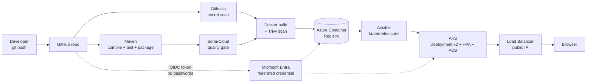

# End-to-End CI/CD on Microsoft Azure (GitHub Actions → ACR → AKS)

A Java (Spring Boot) web app that flows automatically from `git push` to a running, load-balanced deployment on
Azure Kubernetes Service, with security gates on the way.

## Repository layout
| Path | Purpose |
|---|---|
| `src/`, `pom.xml` | Spring Boot app, unit tests (JUnit 5 / MockMvc), JaCoCo coverage |
| `Dockerfile`, `.dockerignore` | Minimal non-root JRE image |
| `.github/workflows/ci-cd.yml` | The pipeline (4 jobs) |
| `k8s/` | Namespace, ServiceAccount, Deployment (template), Service, HPA, PDB |
| `ansible/` | Playbook + inventory that applies the manifests and waits for the rollout |
| `scripts/azure-setup.sh` | One-time Azure provisioning (RG, ACR, AKS, federated identity, roles) |
| `scripts/azure-pause.sh` / `azure-teardown.sh` | Stop costs between sessions / delete everything |
| `.gitleaks.toml`, `.pre-commit-config.yaml` | Secret-scanning config (CI + local hook) |
| `docs/AZURE-GETTING-STARTED.md` | First-time Azure account + Cloud Shell walkthrough |
| `docs/SETUP.md`, `docs/VERIFY.md`, `docs/COST-SAFETY.md` | Setup, verification checks, cost rules |

## Pipeline stages
| Job | Steps | Gate |
|---|---|---|
| `secret-scan` | Gitleaks over full git history | Fails on any detected secret |
| `build-test` | `mvn verify` (compile, tests, JaCoCo, package) → SonarCloud analysis | Tests pass; Sonar quality gate passes |
| `docker` *(main)* | Build image tagged with commit SHA → Trivy scan → push to ACR → capture digest | Fails on fixable HIGH/CRITICAL CVEs |
| `deploy` *(main)* | Azure OIDC login → AKS credentials → `ansible-playbook` → `rollout status` → smoke test | Endpoint must report the **new commit SHA** |

## Best practices implemented
**Pipeline & supply chain**
- Keyless login: **OIDC federated credentials**, no client secret or password exists; trust is limited to this repo (`main` branch and the `production` environment).
- Least-privilege identity: `AcrPush` on one registry, `Cluster Admin Role` on one cluster, read-only `Reader`.
- `permissions: contents: read` by default; `id-token: write` only where needed.
- Build once: the JAR tested in `build-test` is the artifact put in the image.
- Images tagged with the **commit SHA** (never `latest`) and deployed **by digest**.
- Gitleaks + SonarCloud + Trivy run before anything is pushed or deployed; Dependabot for Maven, Docker and Actions.
- `concurrency` control; GitHub Environment `production` can require manual approval.

**Container:** slim JRE, non-root UID 10001, container-aware JVM, OCI labels, tight `.dockerignore`.

**Kubernetes:** Pod Security `restricted` namespace; non-root, read-only root FS, all capabilities dropped, seccomp `RuntimeDefault`, no SA token; resource requests/limits; startup/readiness/liveness probes; zero-downtime rolling updates, 2 replicas, HPA, PodDisruptionBudget.

## Quick start
1. `docs/AZURE-GETTING-STARTED.md`, then `docs/SETUP.md`.
2. Push to `main` and watch the **Actions** tab.
3. `docs/VERIFY.md` proves each control works. When finished: `scripts/azure-teardown.sh`.

## Known limitations
- Plain HTTP on a public IP (add Ingress + certificate + domain for HTTPS).
- Cluster-admin kubeconfig is used for deploys (a namespace-scoped Azure RBAC role would be tighter).
- No NetworkPolicy, image signing or Defender for Containers; single environment.
